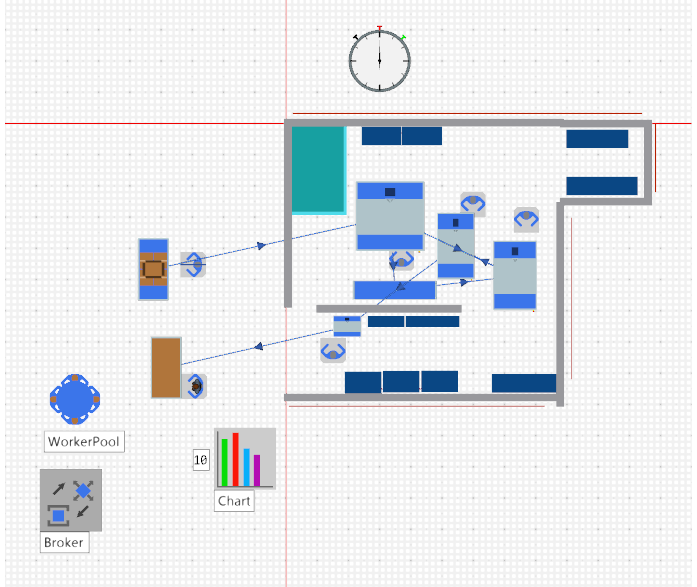
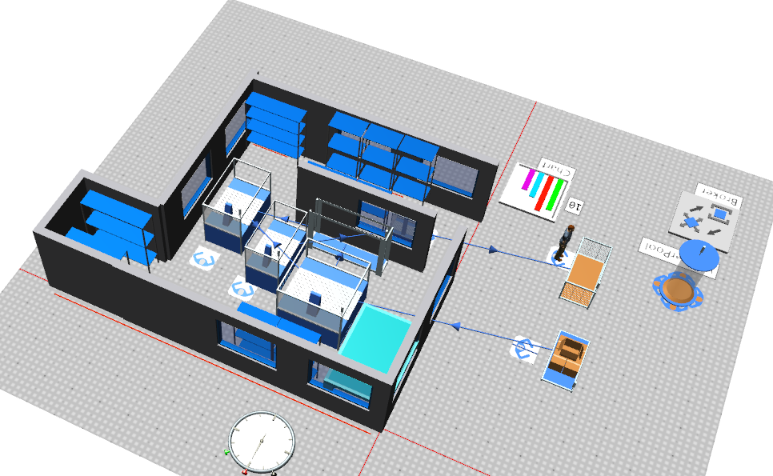
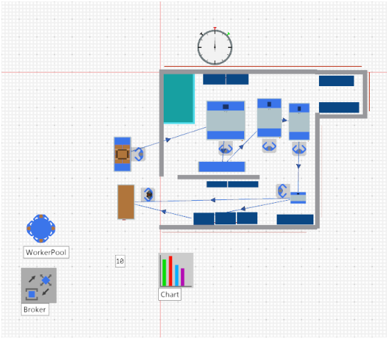
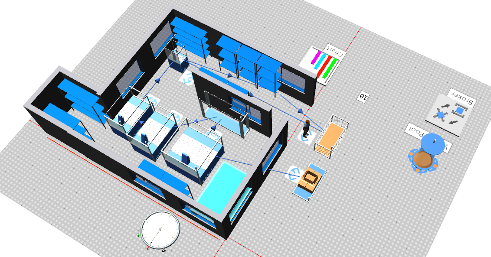

# Smart Printing and Cutting Shop: Production Flow Optimisation

This Production and Operations Management project studies the production flow of a smart printing and cutting shop. The production line sequence was rearranged to improve the flow and reduce production time. The current and optimised layouts were modelled and compared using Siemens Plant Simulation.

| Current version | Optimised version |
| --- | --- |
|  <em>Plan view</em>   <em>3D view</em> |  <em>Plan view</em>   <em>3D view</em> |
